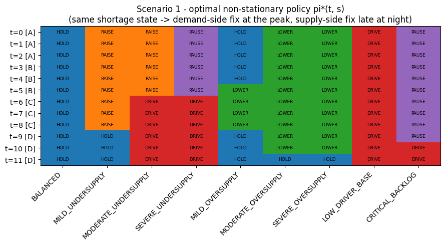
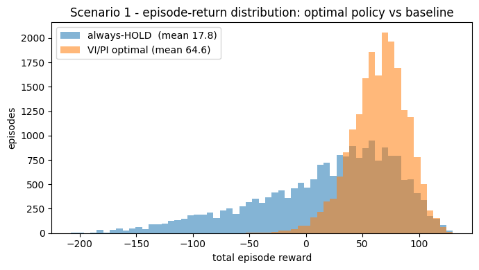
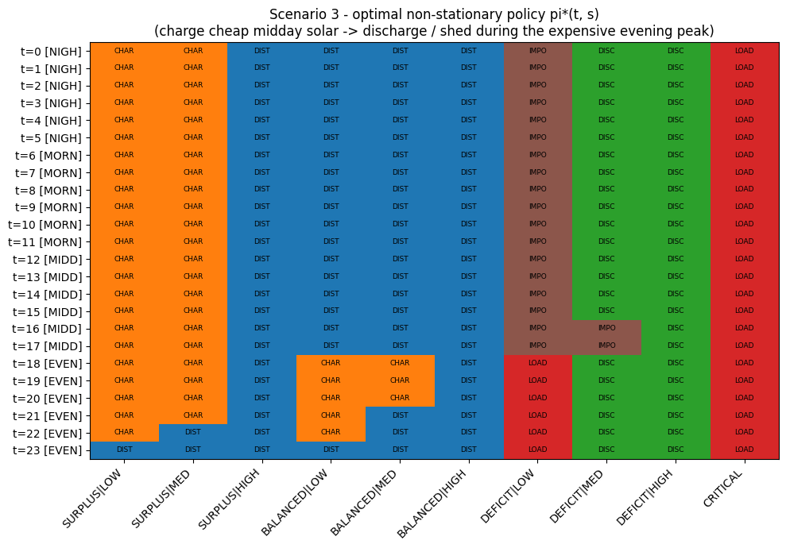
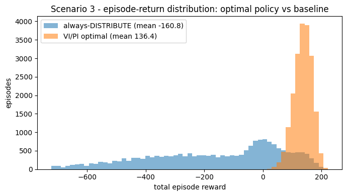

# Finite-Horizon MDPs with Dynamic Programming: Ride-Sharing Pricing and Smart-Grid Energy Management


Two real-world control problems (scenarios 1 and 3 from the assignment brief) are modelled as **finite-horizon Markov Decision Processes with time-varying dynamics** and solved exactly with **Value Iteration** (backward induction) and **Policy Iteration**, both implemented from scratch in NumPy. Each solution is then stress-tested with sensitivity analysis and 20,000-episode Monte-Carlo simulation.

> Built for **UTS 43008 Reinforcement Learning** (Spring 2026), Assignment 1.

---

## Results at a glance

| | Ride-sharing dynamic pricing | Smart-grid energy management |
|---|---|---|
| Horizon / states / actions | T = 12 (every 10 min for 2 h) / 9 / 5 | T = 24 (hourly) / 10 / 6 |
| VI vs PI | Identical policy and values | Identical policy and values |
| Solve time | VI 0.020 ms (12 backups), PI 0.162 ms (4 iterations) | VI 0.042 ms (24 backups), PI 0.402 ms (5 iterations) |
| Non-stationary policy | 7 of 9 states change action over time | 6 of 10 states change action over the day |
| **Avg. episode reward (20,000 sims)** | **64.6** vs 17.8 for *always HOLD* | **136.4** vs −160.8 for *always DISTRIBUTE* |
| Policy unchanged under ±10-15% parameter noise | 87% of the full (t, s) grid on average | 96% of the full (t, s) grid on average |
| Greedy (one-step) policy differs from optimal on | 7 of 9 states | 3 of 10 states |

## Scenario 1: Dynamic pricing for a ride-sharing platform

An operator manages one city zone during a two-hour window. Every 10 minutes they see the demand / supply balance and choose an action.

- **States (9):** `BALANCED`, mild / moderate / severe undersupply, mild / moderate / severe oversupply, `LOW_DRIVER_BASE`, `CRITICAL_BACKLOG`
- **Actions (5):** `HOLD`, `RAISE_PRICE`, `LOWER_PRICE`, `DRIVER_INCENTIVE`, `PAUSE_NEW_REQUESTS`
- **Reward:** `R(s, a) = operating_value(s) + action_cost(s, a)`
- **Dynamics:** transition probabilities change across four demand phases (A to D), modelled by phase-specific reweighting of a base transition matrix



**What the policy learned:** the same shortage state calls for different fixes at different times. At the demand peak the optimal move is demand-side (raise the price). Later in the window it switches to supply-side (pay driver incentives). A stationary policy cannot express this.



## Scenario 3: Energy management in a smart grid

A grid operator decides each hour of a 24-hour day how to handle supply, storage and demand.

- **States (10, factored):** grid situation {`SURPLUS`, `BALANCED`, `DEFICIT`} × battery level {`LOW`, `MED`, `HIGH`}, plus `CRITICAL`
- **Actions (6):** `DISTRIBUTE`, `CHARGE`, `DISCHARGE`, `LOAD_SHED`, `HOLD`, `IMPORT_GRID`
- **Reward:** `R_t(s, a) = situation_value(s) + action_effect(s, a) + tariff_t(a)`, with time-of-use import tariffs (evening imports cost about 4× more than at night)
- **Dynamics:** four phases (night, morning, midday, evening), with solar surplus around midday and deficits in the evening



**What the policy learned:** charge the battery with cheap midday solar, then discharge it (or shed load) during the expensive evening peak instead of importing power. The naive *always DISTRIBUTE* baseline is regularly pushed into `CRITICAL` by evening deficits, which explains its large negative returns and high variance.



## Method

1. **MDP formulation**: states, actions, rewards and time-varying transitions `P_t`. The full rationale for every number is in the report.
2. **Finite-horizon solvers**
   - *Value Iteration*: one backward pass of `T` stage-backups, exact after `T` steps.
   - *Policy Iteration*: repeated full `T`-stage policy evaluation plus greedy improvement until the policy is stable.
3. **Verification**: both solvers must return the identical policy and value function, and this is asserted in the notebook.
4. **Robustness**: 300 (ride-sharing) and 200 (smart-grid) MDPs are re-solved with every hand-designed parameter perturbed by ±10-15%, measuring how much of the optimal policy survives.
5. **Simulation**: 20,000 Monte-Carlo episodes compare the optimal policy against a fixed-action baseline.

**VI vs PI trade-off:** PI needs fewer iterations (4-5), but each one runs a full T-stage evaluation. In wall-clock time, VI is about 8-10× faster on these problems.

## Files

| File | Description |
|---|---|
| [`Scenario1_RideSharing_DynamicPricing.ipynb`](Scenario1_RideSharing_DynamicPricing.ipynb) | Ride-sharing MDP: formulation, solvers, policy, robustness, simulation |
| [`Scenario3_SmartGrid_EnergyManagement.ipynb`](Scenario3_SmartGrid_EnergyManagement.ipynb) | Smart-grid MDP: same structure |
| [`docs/Assignment1_Report.pdf`](docs/Assignment1_Report.pdf) | Report: MDP design rationale, results and comparative analysis |
| [`assets/`](assets/) | Figures used in this README |

## How to run

```bash
pip install numpy pandas matplotlib jupyter
jupyter notebook
```

Both notebooks are self-contained, seeded (`RNG_SEED = 42`) and need only a CPU. They also open directly in Google Colab.

## Limitations

- Transition probabilities and rewards are hand-designed rather than estimated from real data. The sensitivity analysis checks that the conclusions do not hinge on the exact values, but it does not replace real-data calibration.
- Exact DP needs a known model and small state spaces. Larger or unknown environments would call for model-free methods (Q-learning, policy gradients).

## Tech stack

Python, NumPy, pandas, Matplotlib, Jupyter
